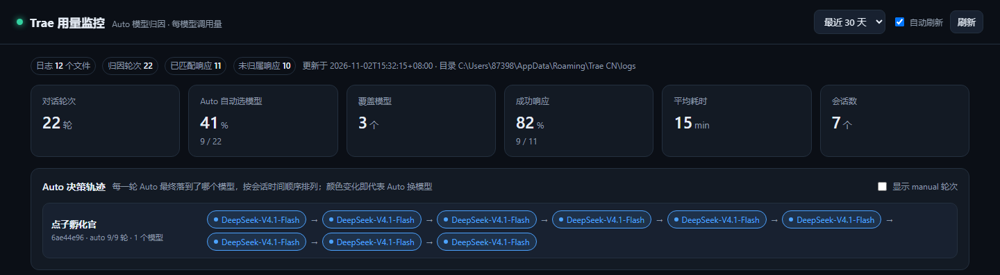
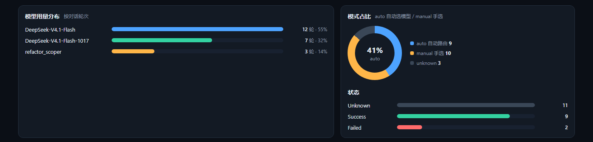
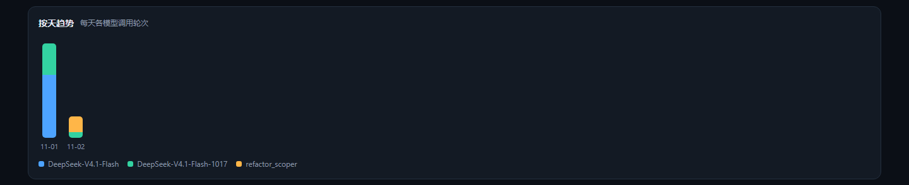
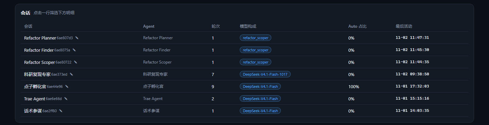
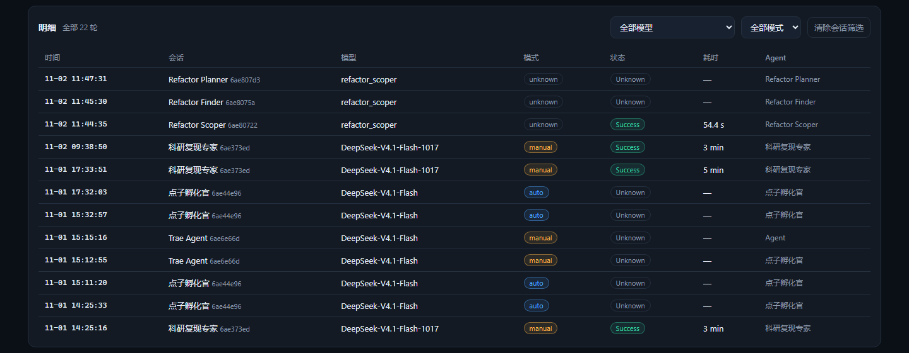
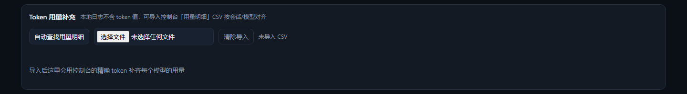

# Trae Usage Monitor · Auto Model Attribution

English | [中文](README.md)

[](https://www.python.org/)
[](LICENSE)
[](#cross-platform-notes)
[](#privacy-and-security)
[](https://github.com/dengjihui1/trae-usage-monitor/releases/latest)
[](https://github.com/dengjihui1/trae-usage-monitor/releases)

Parses Trae's local logs to **recover the model each conversation turn actually landed on**, aggregates call volume per model, and renders it as a local dashboard.



> **The one-line pitch**: in Auto mode Trae picks the model for you, and the UI only ever shows "Auto". This tool recovers the model Auto actually chose, **turn by turn**. Existing open-source tools (TraeUsage, hydee-trae-ai-stats, ...) only report quota or estimate tokens — none of them do routing attribution.

---

## What it is

Trae's Auto mode routes between the models available to you, but all you see is an "Auto" label. That leaves two questions unanswered:

- Of my 100 turns, how many used the expensive model and how many the cheap one?
- This answer was bad — was it routed to a weak model?

This tool digs the answer out of the local logs: **which model each turn used, whether Auto picked it or you did, how long it took, and whether it succeeded** — then aggregates it into a dashboard.

**What it does not do**: it does not check remaining quota (that is not a differentiator, the official console already has it), does not modify the Trae client, and does not touch the network.

---

## Features

### Auto decision trace (the core)

Per session, every turn's model is laid out as a timeline. **A colour change means Auto switched models**, and the switch point is labelled.


A checkbox in the top-right also shows manual turns as dashed chips. Click any row to filter the detail table below.

### Model distribution · mode split · status

See at a glance how concentrated your model usage is, the auto vs. manual ratio, and the success rate.



### Daily trend

Stacked bars of turns per model per day, useful for spotting how your habits change.



### Session list

Click a row to filter the detail table. The first column supports ✎ rename (stored in your browser).



### Detail table

Time / session / model / mode / status / latency / agent, filterable by model and mode.



### Token usage import

Exact token counts are not in the local logs, so you can import the console's "usage details" CSV to fill the gap — with auto-detection.



---

## Quick start

Three ways. Pick whichever fits.

### Option 1: use the exe (no Python needed)

1. **[Download `trae-usage-monitor.exe`](https://github.com/dengjihui1/trae-usage-monitor/releases/latest/download/trae-usage-monitor.exe)** (or pick a version from this repo's Releases page)
2. Double-click it
3. The dashboard opens in your browser

> On first run Windows may show a blue "Windows protected your PC" prompt — the exe is not code-signed (most personal projects are not). Click "**More info → Run anyway**".

### Option 2: run with Python (recommended)

Python 3.10+ required, **no third-party packages needed**.

```bash
git clone https://github.com/dengjihui1/trae-usage-monitor.git
cd trae-usage-monitor
python trae_usage_monitor.py
```

On Windows you can also just double-click `start.bat`.

The browser opens <http://127.0.0.1:8788/> automatically.

### Option 3: build the exe from source

```bash
build.bat            # Windows
```

This produces a single-file `trae-usage-monitor.exe` under `dist\`. For macOS / Linux see "Packaging and distribution" below.

### Command-line flags

```bash
python trae_usage_monitor.py --port 9000          # change port
python trae_usage_monitor.py --no-open            # don't open the browser
python trae_usage_monitor.py --json               # print the parsed result
python trae_usage_monitor.py --out data.json      # export a snapshot
python trae_usage_monitor.py --doctor             # self-check
python trae_usage_monitor.py --log-root "D:\logs" # point at a log root manually
```

---

## Deployment guide

### 1. Keep it running on your own machine

The simplest setup: leave it running in the background and open <http://127.0.0.1:8788/> when you need it.

**Windows**

Right-click `start.bat` → Create shortcut, then drop the shortcut into your Startup folder (press <kbd>Win</kbd>+<kbd>R</kbd>, type `shell:startup`). It will start in the background on every boot.

To run it completely invisibly, create `start-hidden.vbs`:

```vbscript
CreateObject("WScript.Shell").Run "pythonw trae_usage_monitor.py --no-open", 0, False
```

**macOS / Linux**

Just start it in the background with `--no-open`:

```bash
nohup python3 trae_usage_monitor.py --no-open > /dev/null 2>&1 &
```

### 2. Package and distribute

**Windows**

```bash
build.bat
```

**macOS / Linux**

Note the `--add-data` separator differs (Windows uses `;`, macOS/Linux use `:`):

```bash
pip install pyinstaller
pyinstaller --onefile --name trae-usage-monitor --add-data "web:web" trae_usage_monitor.py
```

Output lands in `dist/`. Whoever receives the binary **does not need Python installed**.

> How packaging works: the `web/` directory is bundled via `--add-data`, and at startup the program reads the static assets from PyInstaller's unpack directory (`sys._MEIPASS`). If you move `web/`, update `--add-data` to match.

### 3. Publish to GitHub Releases

1. Make sure the code is pushed:

   ```bash
   git add .
   git commit -m "release: v1.0.0"
   git push
   ```

2. Tag and push the tag:

   ```bash
   git tag v1.0.0
   git push origin v1.0.0
   ```

3. Open your repo on GitHub → **Releases** → **Draft a new release** → pick the tag you just pushed → drag `dist/trae-usage-monitor.exe` into the attachments area → add release notes → publish.

After that the download link in the README works.

---

## Self-check and troubleshooting

The log format is a Trae internal implementation and **may change between versions**. So there is a built-in self-check:

```bash
python trae_usage_monitor.py --doctor
```

Sample output:

```
Trae 用量监控 · 自检
================================================
日志根目录: C:\Users\you\AppData\Roaming\Trae CN\logs
  正常，日志文件 12 个，共 26.5 MB

事件命中（出现次数 / 成功解析）:
  创建请求快照         612 / 612
  用户消息快照          48 / 48
  auto/manual 判定     612 / 612
  响应回执             605 / 605

归因轮次: 612（未归属响应 0）
静态资源: OK
下载目录: C:\Users\you\Downloads
  疑似用量明细 CSV: 0 个

结论：解析正常。
```

**How to read it**

| Symptom | Meaning | Action |
| --- | --- | --- |
| "seen" ≈ "parsed" for every event | Healthy | Nothing to do |
| An event shows "seen but nothing parsed" | Trae changed the log format | Report the output to the author |
| `归因轮次` (turns) is 0 | Nothing parsed at all | Same, and confirm Trae has actually been used |
| `静态资源: 缺失` | Packaging missed `--add-data web` | Rebuild |

Unrecognized lines are **always skipped silently** — a format change degrades the statistics, it never crashes the tool.

If the format really did change, the fix is small: the four event constants at the top of `trae_usage_monitor.py` (`EV_SNAPSHOT` / `EV_AGENTINFO` / `EV_MODE` / `EV_REPORT`) are the only strings you need to update, guided by the `--doctor` output.

---

## Data source and internals

Log locations (auto-detected, in priority order):

| Platform | Path |
| --- | --- |
| Windows | `%APPDATA%\Trae CN\logs\<startup time>\window<n>\renderer*.log` |
| macOS | `~/Library/Application Support/Trae CN/logs/...` |
| Linux | `~/.config/Trae CN/logs/...` |

If none of those exist, sibling directories matching `Trae*` are scanned as a fallback (the folder name differs by distribution: `Trae` / `Trae CN` / `Trae Solo`).

Three kinds of log events are used:

| Event | Purpose | Key fields |
| --- | --- | --- |
| `created chat request selection snapshot` | anchor for one turn | sessionId, messageId, agentId, agentName, modelName, customModelProvider |
| `model auto selection resolved` | whether this turn was auto or manual | sessionId, agentId, strategy(auto/manual), source |
| `reportFrontResponse, status: ...` | result receipt for the turn | model, costTime, errCode, traceId, tokenOutputInterval |

**Attribution rules**

- A snapshot is matched to the **nearest-in-time** `mode` event by `sessionId + agentId` to decide auto vs. manual.
- The `reportFrontResponse` event **carries no sessionId**, so its model name is normalised (`custom_responses_compatible//gpt-6.1-sol` → `gpt-6.1-sol`) and matched against the nearest still-unmatched snapshot.
- Receipts that cannot be matched are counted separately as "**unattributed responses**" instead of being forced onto a session — better to leave a gap than to give you wrong data.

---

## Privacy and security

Tools that read local logs have to state this up front:

- **Local only, no network** — it reads your local Trae logs and makes no network requests, no telemetry, no uploads.
- **Binds to `127.0.0.1` only** — the dashboard HTTP server listens on the loopback address, so other devices on your LAN cannot reach it.
- **No conversation content is extracted** — only the lines carrying the event markers above and the JSON metadata that follows (session id, model name, latency, status, error code, ...) are kept. Your chat content is never stored, displayed or exported.
- **Zero third-party dependencies** — Python standard library only. No pip packages, no supply-chain surface.
- **Auditable** — the whole tool is `trae_usage_monitor.py` plus three front-end files. Read them.

Precise boundary of the "auto-find usage CSV" feature:

- **Scan phase**: reads only the **first 64 KB** of each `.csv` in the downloads folder, to inspect the header. It does not read whole files and does not touch non-CSV files.
- **Import phase**: reads the **single file you selected** in full, and that file must live inside the downloads folder (out-of-bounds paths are rejected by the backend).
- No directory other than the downloads folder is read.

---

## Where session names come from

The short version: **session titles are not available locally**.

Checked: `globalStorage/state.vscdb` (its `chat.ChatSessionStore.index` is empty), `workspaceStorage/*/state.vscdb`, `ModularData/ai-agent/database.db` (encrypted, not readable SQLite), and every log line — none of them carry a session title field. **Titles live in the cloud only.**

So there are two fallback layers:

1. **Default name = agent name.** The `created empty user message selection snapshot` event carries an `agentName`, matched to each turn by `sessionId + agentId`.
2. **Manual rename.** Each row in the session table has a ✎ button; names are stored in the browser's `localStorage`, keyed by sessionId, and survive a restart.

---

## Token usage (important)

**Exact token counts are not available locally**: `token_usage` / `context_usage` only log the event name with no payload, and `ModularData/ai-agent/database.db` is encrypted.

Exact tokens must come from the console: **Personal usage → Usage details**, exported as CSV. The "Token usage" panel offers two import paths:

1. **Auto-find** — click the auto-find button; the tool scans the system downloads folder (Windows `%USERPROFILE%\Downloads`, macOS/Linux `~/Downloads`), scores files by **header keywords** (model / 模型, token / 消耗 / 用量, 调用 / 次数, session / 会话) and imports the best match. If nothing matches it says so and you can fall back to option 2.
2. **Manual pick** — choose a CSV from anywhere.

File name and encoding (UTF-8 / GBK / UTF-16, with or without BOM) do not affect detection. After import, local turns are merged by model name into a "local turns / console call count / token usage" comparison table.

---

## FAQ

<details>
<summary><b>The dashboard is empty / shows 0 turns</b></summary>

Run `python trae_usage_monitor.py --doctor` first.

- "log root does not exist" → Trae has never run, or is installed in a non-default location; point at it with `--log-root`.
- An event shows "seen but nothing parsed" → Trae changed the log format; report the `--doctor` output.
- Everything healthy but still 0 turns → you may have never used Auto mode; no event, no data.

</details>

<details>
<summary><b>Why is the turn count lower than the number of messages I see in Trae?</b></summary>

Only turns that actually issued a model call are counted. A message you sent and then aborted, or a tool action that triggered no model request, does not count.

</details>

<details>
<summary><b>There are a dozen "unattributed responses" — is that a bug?</b></summary>

No, it is a deliberate, conservative design. The `reportFrontResponse` event carries no sessionId, so it is only matched to a turn by "same model name + nearest in time". When that guess is not confident, the receipt is left unattributed rather than forced onto a session, to avoid giving you wrong data.

Truncated rotated logs, or several sessions using the same model at the same time, both push this number up.

</details>

<details>
<summary><b>Session names are all agent names — can I get my real titles?</b></summary>

No, because the data does not exist locally (see "Where session names come from"). You can rename manually; the name is stored locally.

</details>

<details>
<summary><b>Can it show how much money / credits I spent?</b></summary>

Not directly. There are no token values and no pricing rules locally. You can import the console CSV to see the official usage numbers.

</details>

<details>
<summary><b>Windows says "Windows protected your PC", or antivirus flags it</b></summary>

Because the exe is not code-signed (personal open-source projects generally are not). Click "More info → Run anyway". If you would rather not trust a binary, run it from source — it is one file and takes seconds to read.

</details>

<details>
<summary><b>Can I see history from another device?</b></summary>

No. Logs are local, and the tool only reads the local machine.

</details>

---

## Cross-platform notes

- **Windows**: fully supported; `start.bat` / `build.bat` work as-is.
- **macOS / Linux**: core functionality works (log directories are detected per platform), but `build.bat` is a Windows batch file — run the PyInstaller command from "Packaging and distribution" manually.
- The macOS / Linux log paths follow the VS Code family convention and have **not been verified on real hardware**. If you get it running on a Mac (or fail to), please open an issue.

---

## Project structure

```
trae_usage_monitor.py   parser + attribution + HTTP server (single file, zero deps)
web/index.html          dashboard markup
web/app.css             styles
web/app.js              aggregation, rendering, CSV import
start.bat               one-click launch (Windows)
build.bat               build a single-file exe (PyInstaller)
docs/                   README screenshots
README.md               Chinese readme
README.en.md            this file
LICENSE                 MIT
.gitignore              build artifacts
```

---

## Known limitations

- **No exact tokens** — the local logs have no token values; import the console CSV instead.
- **No session titles** — titles are cloud-only; the default is the agent name and can be renamed manually.
- **Depends on the log format** — it is a Trae internal implementation and may change; `--doctor` diagnoses it quickly.
- **This machine only** — logs are local, so another device is invisible.
- **Auto attribution only** — no quota lookup, no cost conversion.

---

## Contributing

Issues are welcome — please attach the full `--doctor` output, which is the fastest way to tell whether the log format changed.

## License

[MIT](LICENSE) © 2026 Trae Usage Monitor contributors

> This tool is not affiliated with Trae / ByteDance in any way. It is an independent third-party open-source project.
