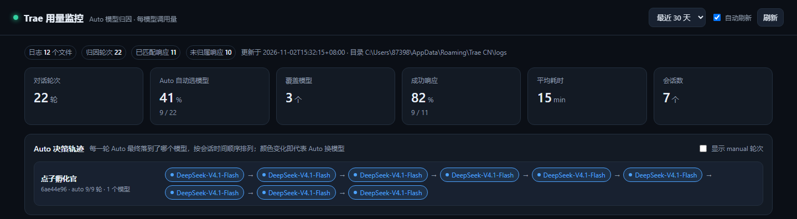
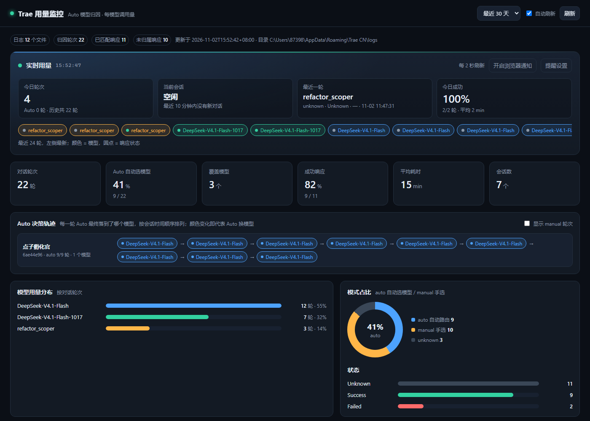
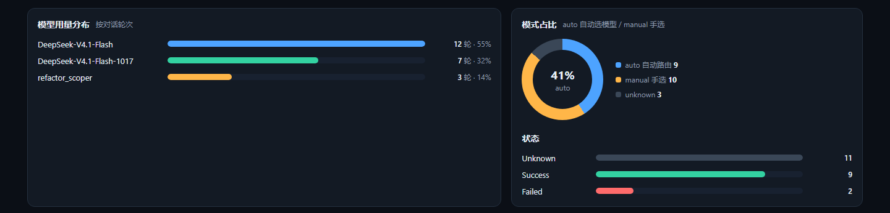
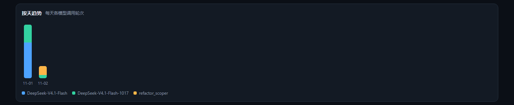
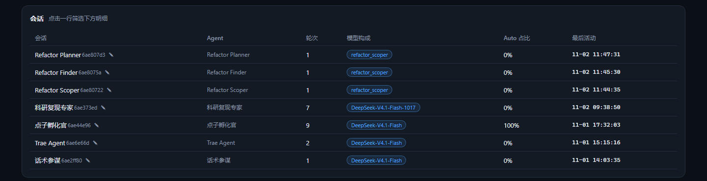
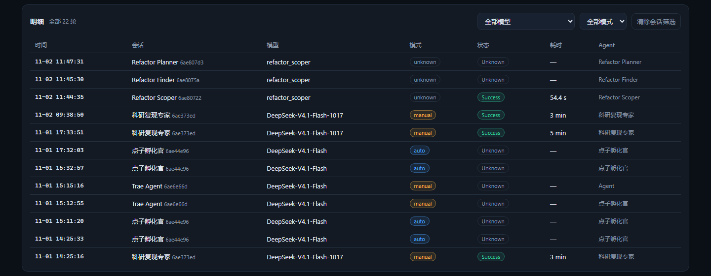

# Trae 用量监控 · Auto 模型归因

[English](README.en.md) | 中文

[](https://www.python.org/)
[](LICENSE)
[](#跨平台说明)
[](#隐私与安全)
[](https://github.com/dengjihui1/trae-usage-monitor/releases/latest)
[](https://github.com/dengjihui1/trae-usage-monitor/releases)

解析 Trae 客户端的本地日志，**还原每一轮对话实际落到的模型**，统计每个模型的调用量，并给出一个本地可视化看板。



> **一句话讲清差异化**：Auto 模式下 Trae 自动帮你挑模型，界面上永远只显示「Auto」。这个工具把 Auto 真正选中的模型**逐轮还原**出来。现有的开源工具（TraeUsage、hydee-trae-ai-stats 等）都只统计额度或估算 token，没有做路由归因。

---

## 这是什么

Trae 的 Auto 模式会自动在你可用的模型之间路由，但你看到的只是一个「Auto」标签。这就带来两个无法回答的问题：

- 我这 100 轮对话，到底有多少轮用了贵的模型、多少轮用了便宜的？
- 这次回答质量不行，是不是因为被路由到了弱模型？

这个工具从本地日志里把答案挖出来：**每一轮对话用了哪个模型、是 auto 选的还是你手选的、耗时多少、成功还是失败**，然后聚合成看板。

**它不做什么**：不查剩余额度（那不是差异化，官方控制台已经有了），不改 Trae 客户端，不联网。

---

## 功能一览

### 实时用量面板 + 用量提醒（v1.1 新增）

页面顶部常驻一块**秒级跳动**的实时面板：今日轮次、当前活跃会话、最近一轮落到哪个模型、今日成功率，以及一条最近 24 轮的模型流水（颜色 = 模型，圆点 = 响应状态）。



**用量提醒**是一组你能自己调的阈值规则，触发后在页面顶部显示提醒条，可选再推一条桌面通知 / 托盘气泡：

| 规则 | 默认阈值 | 说明 |
| --- | --- | --- |
| 今日轮次超阈 | 300 轮 | 当天累计对话轮次超过阈值 |
| 单会话轮次超阈 | 80 轮 | 某一个会话当天轮次超过阈值 |
| 失败率超阈 | 20%（≥5 轮样本） | 有明确回执的轮次里失败占比过高 |
| 平均耗时超阈 | 默认关闭 | 平均响应耗时过高 |
| Auto 命中指定模型 | 默认关闭 | Auto 路由落到了你特别关注的模型 |

> **为什么叫「用量提醒」而不是「额度提醒」？**
> 本地日志里**没有额度余额，也没有 token 数值**，所以做不到真正的额度预警。用轮次去反推额度会严重误导——不同模型单价差几十倍，100 轮 Auto 和 100 轮手选贵模型的消耗完全不是一回事。所以这里只提醒**本地看得见的用量指标**（轮次 / 耗时 / 失败率 / 模型路由），数字口径都来自真实日志，不猜、不算卦。

提醒是**状态型**而不是事件型：条件成立就一直显示，条件解除自动消失，刷新页面或重开也不会重复堆叠。

### Auto 决策轨迹（核心）

按会话把每一轮的模型排成一条时间线，**颜色一变就代表 Auto 换了模型**，换模型的位置会标出「切换」。


右上角可以勾选把 manual 轮次一起显示（虚线胶囊），点任意一行即可筛选下方明细。

### 模型用量分布 · 模式占比 · 状态

一眼看清模型构成的集中度、auto 与手选的比例、以及成功率。



### 按天趋势

每天各模型的调用轮次堆叠柱，用来观察自己的使用习惯变化。



### 会话列表

点行筛选下方明细，首列支持 ✎ 手动改名（名字存在浏览器本地）。



### 明细表

时间 / 会话 / 模型 / 模式 / 状态 / 耗时 / Agent，可按模型和模式过滤。



### Token 用量补充

本地日志拿不到 token 数值，可以导入控制台导出的「用量明细」CSV 来补齐，支持自动查找。


---

## 快速开始

三种方式，按你的情况挑一个。

### 方式一：直接用 exe（不装 Python 的人选这个）

1. **[点此直接下载 `trae-usage-monitor.exe`](https://github.com/dengjihui1/trae-usage-monitor/releases/latest/download/trae-usage-monitor.exe)**（或到本仓库的 Releases 页面挑选版本）
2. 双击运行
3. 浏览器会自动打开看板

> 首次运行 Windows 可能弹出蓝色的「Windows 已保护你的电脑」提示 —— 这是因为 exe 没有购买代码签名证书（个人项目基本都这样），点「**更多信息 → 仍要运行**」即可。

### 方式二：用 Python 跑（推荐）

需要 Python 3.10+，**核心功能不需要装任何第三方包**（系统托盘是可选增强，见下文）。

```bash
git clone https://github.com/dengjihui1/trae-usage-monitor.git
cd trae-usage-monitor
python trae_usage_monitor.py
```

Windows 用户也可以直接双击 `start.bat`。

浏览器会自动打开 <http://127.0.0.1:8788/>。

### 方式三：从源码构建 exe

```bash
build.bat            # Windows
```

会在 `dist\` 下生成单文件 `trae-usage-monitor.exe`。macOS / Linux 见下面的「打包分发」。

### 命令行参数

```bash
python trae_usage_monitor.py --port 9000          # 换端口
python trae_usage_monitor.py --no-open            # 不自动开浏览器
python trae_usage_monitor.py --no-tray            # 不启用系统托盘
python trae_usage_monitor.py --json               # 直接打印解析结果
python trae_usage_monitor.py --out data.json      # 导出快照
python trae_usage_monitor.py --doctor             # 自检
python trae_usage_monitor.py --log-root "D:\logs" # 手动指定日志根目录
```

### 系统托盘（可选增强）

核心功能**零第三方依赖**。系统托盘是可选增强：装了 `pystray` + `Pillow` 就自动启用，没装就静默降级成「只有页面内实时面板」，不影响任何其它功能。

```bash
pip install pystray pillow
```

启用后任务栏会出现一个图标：

- **图标颜色 = 当前状态**：绿色正常 / 黄色有提醒 / 红色有失败率类提醒，带红点角标
- **鼠标悬停**：`今日 N 轮 · 最近 <模型> · M 条提醒`
- **左键单击 / 菜单第一项**：打开看板
- **菜单「用量提醒」**：一键开关提醒（与页面共用同一份设置）
- **菜单「退出监控」**：关掉整个服务

> 托盘和页面是解耦的：托盘通过本机 `127.0.0.1` 上的 `/api/live` 接口取数，所以页面开不开着都不影响托盘工作。

---

## 部署教程

### 1. 在自己电脑上长期使用

最省事的思路：让它在后台常驻，需要时打开 <http://127.0.0.1:8788/>。

**Windows**

在 `start.bat` 上右键 → 创建快捷方式，把快捷方式丢进「启动」文件夹（<kbd>Win</kbd>+<kbd>R</kbd> 输入 `shell:startup`），开机就会自动在后台跑。

想彻底隐身运行，建一个 `start-hidden.vbs`：

```vbscript
CreateObject("WScript.Shell").Run "pythonw trae_usage_monitor.py --no-open", 0, False
```

**macOS / Linux**

用 `--no-open` 后台启动即可：

```bash
nohup python3 trae_usage_monitor.py --no-open > /dev/null 2>&1 &
```

### 2. 打包分发给别人

**Windows**

```bash
build.bat
```

**macOS / Linux**

注意 `--add-data` 的分隔符不同（Windows 用 `;`，macOS/Linux 用 `:`）：

```bash
pip install pyinstaller
pyinstaller --onefile --name trae-usage-monitor --add-data "web:web" trae_usage_monitor.py
```

产物在 `dist/` 下。拿到 exe / 可执行文件的人**不需要装 Python**，双击即用。

> 打包原理：`web/` 目录通过 `--add-data` 一起打进去，程序启动时从 PyInstaller 的解包目录（`sys._MEIPASS`）读取静态资源。如果你自己改了 `web/` 的路径，记得同步改 `--add-data`。

### 3. 发布到 GitHub Releases

1. 确认代码已推送：

   ```bash
   git add .
   git commit -m "release: v1.0.0"
   git push
   ```

2. 打 tag 并推送：

   ```bash
   git tag v1.0.0
   git push origin v1.0.0
   ```

3. 打开 GitHub 仓库 → **Releases** → **Draft a new release** → 选择刚推送的 tag → 把 `dist/trae-usage-monitor.exe` 拖进附件区 → 写说明 → 发布。

之后别人就能从 Releases 页直接下载 exe，README 里的下载指引会自动生效。

---

## 自检与排错

日志格式是 Trae 的内部实现，**升级后可能变**。所以内置了一个自检命令：

```bash
python trae_usage_monitor.py --doctor
```

输出示例：

```
Trae 用量监控 · 自检
================================================
日志根目录: C:\Users\you\AppData\Roaming\Trae CN\logs
  正常，日志文件 12 个，共 26.5 MB

事件命中（出现次数 / 成功解析）:
  创建请求快照         612 / 612
  用户消息快照          48 / 48
  auto/manual 判定     612 / 612
  响应回执             605 / 605

归因轮次: 612（未归属响应 0）
静态资源: C:\...\_MEIPASS\web  OK
系统托盘: 可用（pystray + Pillow 已安装）
提醒设置: C:\Users\you\.trae-usage-monitor\settings.json
下载目录: C:\Users\you\Downloads
  疑似用量明细 CSV: 0 个

结论：解析正常。
```

**怎么读这个输出**

| 现象 | 含义 | 怎么办 |
| --- | --- | --- |
| 「出现次数」≈「成功解析次数」 | 正常 | 无需处理 |
| 某事件「出现了但一条都没解析出来」 | Trae 改了日志格式 | 把整段输出反馈给作者 |
| `归因轮次` 为 0 | 完全没解析到 | 同上，并确认 Trae 至少用过一次 |
| `静态资源: 缺失` | 打包时漏了 `--add-data web` | 重新打包 |
| `系统托盘: 不可用` | 没装可选的 `pystray` / `Pillow` | 想要托盘就 `pip install pystray pillow`，不装不影响其它功能 |

解析器对不认识的行**永远是静默跳过**，不会因为格式变化而崩溃报错 —— 最差情况是统计变少，不会把整个工具搞挂。

如果格式真的变了，改法很简单：`trae_usage_monitor.py` 顶部有四个事件常量（`EV_SNAPSHOT` / `EV_AGENTINFO` / `EV_MODE` / `EV_REPORT`），按 `--doctor` 的输出改掉对应字符串即可。

---

## 数据来源与原理

日志位置（自动探测，按优先级）：

| 平台 | 路径 |
| --- | --- |
| Windows | `%APPDATA%\Trae CN\logs\<启动时间>\window<n>\renderer*.log` |
| macOS | `~/Library/Application Support/Trae CN/logs/...` |
| Linux | `~/.config/Trae CN/logs/...` |

若上述目录不存在，会在同级目录里自动扫描 `Trae*` 再找一遍（不同发行版的目录名可能是 `Trae` / `Trae CN` / `Trae Solo`）。

用到三类日志事件：

| 事件 | 作用 | 关键字段 |
| --- | --- | --- |
| `created chat request selection snapshot` | 一轮请求的锚点 | sessionId, messageId, agentId, agentName, modelName, customModelProvider |
| `model auto selection resolved` | 该轮是 auto 还是手选 | sessionId, agentId, strategy(auto/manual), source |
| `reportFrontResponse, status: ...` | 该轮的结果回执 | model, costTime, errCode, traceId, tokenOutputInterval |

**归因规则**

- snapshot 按 `sessionId + agentId` 找**时间最近**的 mode 事件，判定这一轮是 auto 还是 manual。
- `reportFrontResponse` 事件里**不含 sessionId**，所以按模型名归一化（`custom_responses_compatible//gpt-6.1-sol` → `gpt-6.1-sol`）后，与最近的、尚未匹配的 snapshot 对齐。
- 对不上的回执单独计入「**未归属响应**」，不会硬塞给某一路会话 —— 宁可不猜，也不给你错的数据。

---

## 隐私与安全

这类要读本地日志的工具，必须先把话说清楚：

- **纯本地，不联网** —— 只读本机 Trae 日志，没有任何网络请求、没有遥测、不上传任何数据。
- **只监听 `127.0.0.1`** —— 看板 HTTP 服务只绑定本机回环地址，同一局域网内的其它设备访问不到。
- **不提取对话正文** —— 只截取含上述事件标识的行及其后面的 JSON 元数据（会话 ID、模型名、耗时、状态、错误码等），不会保存、展示或输出你与 AI 的对话内容。
- **零第三方依赖（核心）** —— 解析、归因、HTTP 服务、前端全部只用 Python 标准库与原生 Web 技术，没有 pip 依赖，不存在供应链风险。系统托盘是唯一可选增强，需要你主动 `pip install pystray pillow` 才会启用。
- **设置可读可删** —— 提醒阈值存在 `~/.trae-usage-monitor/settings.json`（Windows 为 `C:\Users\<你>\.trae-usage-monitor\settings.json`），纯文本 JSON，随时可查看或删除。
- **可审计** —— 全部代码 = `trae_usage_monitor.py` + 三个前端文件，欢迎自行通读。

关于「自动查找用量明细」的权限边界，说准确些：

- **扫描阶段**：只读取下载目录中每个 `.csv` 的**前 64 KB** 用来识别表头，不读全文、不读非 CSV 文件。
- **导入阶段**：只读取**你选中的那一个文件**的全文，且该文件必须位于下载目录内（路径越界会被后端直接拒绝）。
- 除下载目录外，程序不读取任何其它目录。

---

## 会话名字从哪来

先说结论：**本地拿不到会话标题**。

查过了：`globalStorage/state.vscdb`（其中 `chat.ChatSessionStore.index` 是空的）、`workspaceStorage/*/state.vscdb`、`ModularData/ai-agent/database.db`（加密，不是可读 SQLite）、以及所有日志文本 —— 都没有会话标题字段。**标题只存在云端。**

所以做了两层兜底：

1. **默认名 = Agent 名**。日志里 `created empty user message selection snapshot` 带 `agentName`（如「科研复现专家」「点子孵化官」），按 `sessionId + agentId` 关联到每一轮。
2. **支持手动改名**。会话表每行有 ✎，起的名字存在浏览器 `localStorage`，按 sessionId 持久化，重启看板仍在。

---

## Token 用量说明（重要）

本地日志**拿不到精确 token**：`token_usage`、`context_usage` 只打印事件名不带 payload；会话库 `ModularData/ai-agent/database.db` 是加密的。

精确 token 只能从控制台补：**个人用量 → 用量明细**，可导出 CSV。页面的「Token 用量补充」面板有两种导入方式：

1. **自动查找** —— 点「自动查找用量明细」，程序扫描系统下载目录（Windows `%USERPROFILE%\Downloads`，macOS/Linux `~/Downloads`），按**表头关键字**打分挑出像用量明细的 CSV（识别 model / 模型、token / 消耗 / 用量、调用 / 次数、session / 会话），自动导入匹配度最高的一个。找不到会明确提示，可改用第 2 种方式。
2. **手动选择** —— 直接选任意位置的 CSV 文件。

文件名和编码（UTF-8 / GBK / UTF-16，带不带 BOM）都不影响识别。导入后按模型名合并本地轮次，输出「本地轮次 / 控制台调用次数 / Token 消耗」对照表。

---

## 常见问题

<details>
<summary><b>看板是空白的 / 显示 0 轮对话</b></summary>

先跑 `python trae_usage_monitor.py --doctor`。

- 「日志根目录不存在」→ Trae 没运行过，或装在非默认位置，用 `--log-root` 手动指定。
- 事件「出现了但一条都没解析出来」→ Trae 改了日志格式，请把 `--doctor` 的输出反馈给作者。
- 一切正常但还是 0 轮 → 你可能从来没用过 Auto 模式；日志里没有对应事件就没有数据。

</details>

<details>
<summary><b>为什么统计的轮次比我在 Trae 里看到的消息条数少？</b></summary>

只统计**真正发起了模型调用**的轮次。你发一条消息但中断了、或者工具类操作没有触发模型请求，都不会计入。

</details>

<details>
<summary><b>「未归属响应」有十几个，是 bug 吗？</b></summary>

不是 bug，是**保守设计的副作用**。`reportFrontResponse` 事件不带 sessionId，只能按「模型名 + 时间邻近」去猜它属于哪一轮。猜不准的宁可标成「未归属」，也不硬塞给某一路会话，免得给你错的数据。

轮转日志被截断、或同一时刻有多个会话用同一个模型时，未归属数会偏高。

</details>

<details>
<summary><b>会话名全是 Agent 名，能显示我真实的会话标题吗？</b></summary>

不能，原因是本地根本没有这个数据（见上面的「会话名字从哪来」）。可以手动改名，改完会存在本地。

</details>

<details>
<summary><b>用量提醒为什么不能提醒「额度快用完了」？</b></summary>

因为本地根本没有额度余额这个数据。日志里没有余额、没有 token 数值、没有计价规则，控制台接口也需要登录凭证。所以能做的只有**基于本地可见指标的用量提醒**（今日轮次、单会话轮次、失败率、平均耗时、Auto 是否命中指定模型）。

如果哪天真要做额度预警，只能接官方控制台接口，代价是要你提供登录凭证 —— 那会破坏「纯本地、零凭证」这个前提，暂时不做。

</details>

<details>
<summary><b>提醒不触发 / 一直不消失？</b></summary>

- **不触发**：先去「提醒设置」确认总开关和对应规则都是开的，再看阈值是否定得太高（默认「今日轮次」是 300 轮，日常用一般碰不到，可以调小来验证）。
- **不消失**：提醒是状态型的，只要条件还成立就一直显示——比如「今日轮次超阈」要到第二天零点才会自动清空。想立刻清掉就当场把阈值调大。
- **浏览器通知没弹出**：需要在页面点一次「开启浏览器通知」授权；`127.0.0.1` 属于安全上下文，正常情况下可用。托盘气泡则要求托盘已启用。

设置存在 `~/.trae-usage-monitor/settings.json`，删除这个文件即可回到默认值。

</details>

<details>
<summary><b>能显示我花了多少钱 / 多少积分吗？</b></summary>

不能直接算。本地没有 token 数值，也没有计价规则。只能导入控制台 CSV 看官方口径的用量数字。

</details>

<details>
<summary><b>Windows 提示「已保护你的电脑」/ 杀毒软件报警</b></summary>

因为 exe 没有代码签名证书（个人开源项目一般不会买）。点「更多信息 → 仍要运行」。不放心的可以直接用源码跑，代码就一个文件，几秒就能读完。

</details>

<details>
<summary><b>换个设备能看到之前的记录吗？</b></summary>

不能。日志只在本机，工具也只读本机。

</details>

---

## 跨平台说明

- **Windows**：完整支持，`start.bat` / `build.bat` 可直接用，系统托盘已实测可用。
- **macOS / Linux**：核心功能可用（日志目录已按平台探测），但 `build.bat` 是 Windows 批处理，需按上面的「打包分发」手动执行 PyInstaller 命令。
- **系统托盘**：在 Windows 上实测可用。macOS 上 `pystray` 要求跑在主线程，而本工具的主线程被 HTTP 服务占用，托盘可能装不上 —— 此时会**静默降级**为仅页面模式，不影响任何其它功能。
- macOS / Linux 的日志路径按 VS Code 系惯例推断，**尚未在真机验证过**。如果你在 Mac 上跑通了（或跑不通），欢迎开 issue 反馈。

---

## 项目结构

```
trae_usage_monitor.py    解析 + 归因 + 提醒求值 + HTTP 服务（单文件，核心零依赖）
web/index.html           看板结构
web/app.css              样式
web/app.js               聚合与渲染、实时面板、提醒设置、CSV 导入
start.bat                一键启动（Windows）
build.bat                打包单文件 exe（PyInstaller，含可选托盘依赖）
docs/                    README 截图
README.md                中文说明（本文件）
README.en.md             English readme
LICENSE                  MIT
.gitignore               排除构建产物
```

运行时会在用户主目录生成一个设置文件（可随时删除）：

```
~/.trae-usage-monitor/settings.json    提醒阈值与刷新间隔
```

---

## 已知限制

- **拿不到精确 token** —— 本地日志没有 token 数值，只能靠导入控制台 CSV 补。
- **拿不到额度余额** —— 所以只能做「用量提醒」，做不了「额度预警」（见上文说明）。
- **拿不到会话标题** —— 标题只存在云端，默认显示 Agent 名，可手动改名。
- **依赖日志格式** —— 属 Trae 内部实现，升级后可能变；用 `--doctor` 可快速判断。
- **只统计本机** —— 日志在本地，换设备看不到。
- **仅覆盖 Auto 归因** —— 不做额度查询，不做成本换算。
- **托盘为可选增强** —— 需要 `pystray` + `Pillow`；macOS 上可能不可用，会自动降级。

---

## 贡献

发现问题欢迎开 issue，最好附上 `--doctor` 的完整输出 —— 这是定位「日志格式是否变了」最快的办法。

## 许可

[MIT](LICENSE) © 2026 Trae Usage Monitor contributors

> 本工具与 Trae / 字节跳动无任何关联，为第三方独立开源项目。
